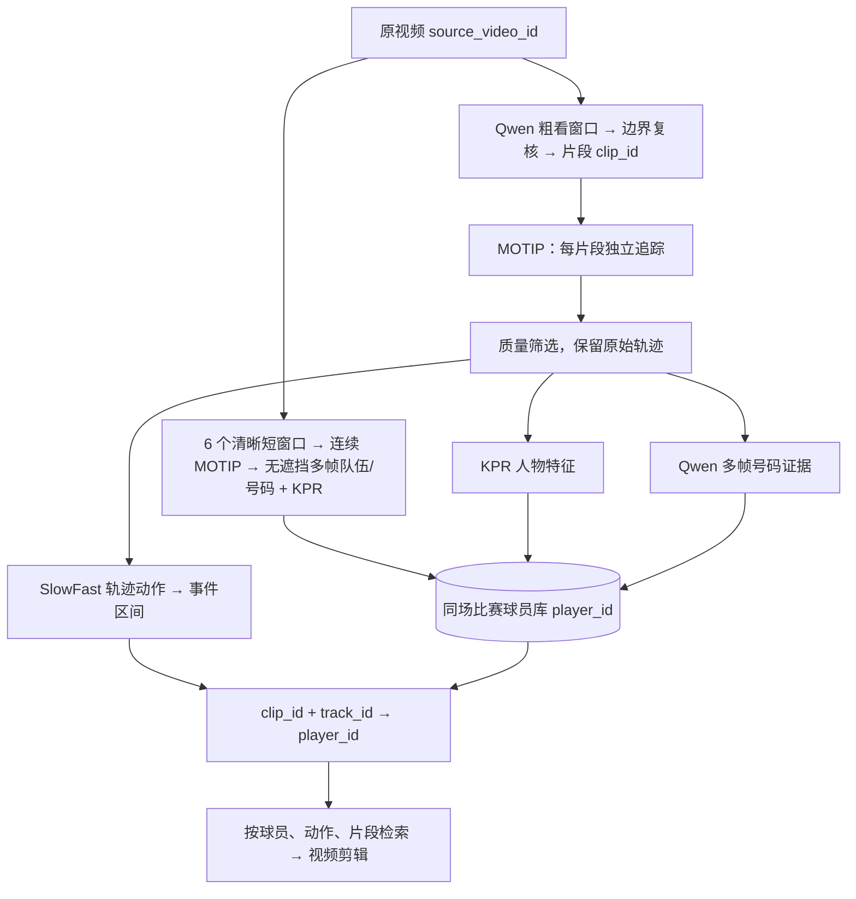

# CourtVision · 篮球视频与同场球员库

先从一场比赛的长视频选取 6 个清晰短窗口，各自连续运行 MOTIP，再筛选清晰、无遮挡的人物轨迹建立候选球员库。明确的多帧队伍与号码共识作为强身份线索，KPR 辅助关联。长视频再经过 Qwen3-VL 状态观察、边界复核后切成片段，逐片段运行 MOTIP。轨迹的 KPR 外观特征与 Qwen 球衣号码证据一起更新同场球员库；SlowFast 动作按片段和轨迹关联到球员。前端以球员照片为入口，支持检索、复核与视频剪辑，并展示流程统计和已有标注的切分指标。



## ID 与时间

| 字段 | 含义 |
| --- | --- |
| `match_id` | 一场比赛；一份球员库只属于这一场 |
| `source_video_id` | 原视频内容 SHA-256 派生的 `SRC-*` |
| `clip_id` | 原视频与切分起止时间派生的 `CL-*`；切点改变则 ID 改变 |
| `track_id` / `raw_track_ids` | MOTIP 在片段内的数字 ID；不同片段可以重复 |
| `track_uid` / `track_uids` | `clip_id:T0000`，用于唯一定位轨迹 |
| `local_person_id` | 片段内档案 ID `P*`，保留旧接口与审计证据 |
| `player_id` | 同场持久化身份 `PL-*`，兼容字段为 `global_person_id` |
| `event_id` | 动作事件 ID，关联片段、原轨迹和当前球员 |

事件 `start/end` 是片段内秒数；`source_start_s/source_end_s` 是原视频秒数。来源时间从原视频首个视频呈现时间戳开始计算，不是比赛计时器。导出片段明确转为 CFR，供现有 `frame_idx/fps` 后端使用，切点量化误差随元数据保存。

## 运行

在仓库根目录执行。控制环境与各 GPU 环境独立，私人解释器和权重路径参考 [.env.example](.env.example)；部署见 [GPU 环境](docs/gpu.md)。控制机需要 `ffmpeg`、`ffprobe`。

```bash
bash tools/setup_control.sh
.venv/bin/python -m cli.check_runtime --env-file .env
.venv/bin/python -u -m cli.process_match \
  --env-file .env --match-id game-001 \
  --input runtime/data/game-001.mp4 \
  --output-dir runtime/outputs/game-001
```

`--dry-run` 查看计划，不加载模型。`--stage initialize` 只测试 6 个初始化窗口，默认每个 4 秒；也可通过 `--bootstrap-windows-file` 提供六个起点秒数。`--stage segment` 只切分；`--stage process --limit 1` 先处理一个已导出片段，移除 `--limit` 后继续全部。切分参数、人工修订、断点恢复和检索剪辑见 [完整流程](docs/workflow.md)。

已有短视频仍可使用 `cli.process_batch --input-dir ... --output-dir ... --match-id ...`。同一批次的历史成员不会因为本次只选部分片段而删除。单张 GPU 串行运行，Qwen 切分子进程退出后才启动 MOTIP；每片段执行：

`tracking → quality → action → aggregate → identity → resolution → jersey → players → link → render → review`

## 球员库与网页

初始化使用原分辨率、原帧率的 FFV1 无损短窗口。每个时间层做少量检测探查，选择清晰人物较多的窗口；探查图不建立身份。每个窗口从零开始连续 MOTIP 追踪，不跨不相邻窗口保留追踪状态。人物尺寸、清晰度、画面边缘完整性和重叠率先做硬筛选，Qwen 再判断球员角色、无遮挡、队服颜色、号码和朝向。至少两个相隔 0.5 秒的清晰帧支持队伍与号码，才作为初始身份锚点；单帧号码、同号异队、冲突读数不会直接合并。自动队伍是比赛内匿名的 `KIT-*`，不能推断主客队；颜色不明确时保留待定，也可配置颜色到队伍的映射。

同队同号的独立强证据可关联不同外观模式，KPR 距离保留作辅助依据。没有明确号码的清晰轨迹可以通过严格外观规则补充已有身份，尚不能关联的保留待处理。每人最多 6 个模板，同一已知朝向最多 2 个，缺少其他朝向不会阻止建库。多角度标签来自 Qwen，仍需实测核查。

KPR 权重固定，增量更新数据库和外观图库。纯外观距离默认 `0.12`，有号码支持时为 `0.2`，候选差 `0.05`，均是待验证工程初值。更新、重处理、拒绝和回滚机制保留；低质量图不进入初始库，原始证据保留便于排查。球员 ID 不重新编号、不跨比赛合并。旧照片库仅保留审计与维护兼容，新流程不再使用独立照片建库，换用新输出目录测试。[参数与维护说明](docs/workflow.md#追踪身份与动作)。

```bash
.venv/bin/python -m cli.serve_web --env-file .env --host 0.0.0.0 --port 6006
```

网页“导入结果”选择长视频运行目录下的 **`results/`**。流程页显示原视频、片段时间和 Qwen 边界证据；球员库可查看原尺寸模板、朝向、队伍/号码来源，并下载初始化短窗口；支持、调整身份、检索动作，并下载动作前后各一秒或整个对应片段。号码、模型分数和处理成功均不代表准确率。服务通过平台受控端口访问。

SQLite 是身份事实来源，JSON 是按修订号发布的可浏览索引。人工修正后检索和导出读取当前归属，无须重新运行模型。已注册的特征、号码或动作证据不能被静默覆盖；改变模型或切点后使用新的输出目录，保留旧数据库和证据。

## 文件管理与验证

| 目录 | 职责 |
| --- | --- |
| `pipeline/segmentation`、`pipeline/media.py` | Qwen 切分、时间映射、CPU 视频导出 |
| `pipeline/tracking` | MOTIP、轨迹质量 |
| `pipeline/identity` | KPR、号码证据、持久化球员库 |
| `pipeline/action`、`adapters/mmaction2` | 原有 MultiSports SlowFast 动作方案 |
| `contracts`、`workflows`、`cli` | 数据契约、执行编排、命令行入口 |
| `web` | 检查、身份修正、检索与下载 |
| `analysis` | CPU 自检、数据集评估 |
| `MOTIP`、`MMAction2` | 保留的上游实现 |

权重、环境、私人配置、原视频和输出均不提交 Git。部署目录可继续分为 `model/`、`tool/`、`env/`、`basket_cut/`、`data/`、`output/`。

`cli.check_match` 实际执行合成视频的窗口切分、边界合并、来源映射、身份检索和 FFmpeg 导出；模型回答使用明确标注的合成输入。其他 CPU 检查由 `tools/setup_control.sh` 执行。真实 Qwen 切分及 MOTIP/KPR/SlowFast 联合推理需要在有空闲 GPU 时另行验证。

保留独立的 [SportsMOT 原始帧评估](docs/sportsmot.md) 、[TeamTrack 评估](docs/teamtrack.md) 和 [TrackID3x3 评估](docs/trackid.md)，不把业务切分混入基准评估。模型来源：[MOTIP](https://github.com/MCG-NJU/MOTIP)、[KPR](https://github.com/VlSomers/keypoint_promptable_reidentification)、[MMAction2](https://github.com/open-mmlab/mmaction2)、[Qwen3-VL](https://github.com/QwenLM/Qwen3-VL)。
