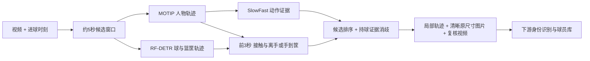

# CourtVision · link_player

从篮球视频的进球时刻定位出手球员，导出可复核轨迹和身份图片，供下游球员库检索、剪辑使用。进球时刻由外部模块或人工标注提供。



## 使用

控制环境和各模型环境独立配置，路径见 [.env.example](.env.example)，安装见 [GPU 环境](docs/gpu.md)。控制机需要 FFmpeg。

```bash
python -m cli.link_player --env-file .env \
  --input-dir /path/to/videos --annotations /path/to/annotations.csv \
  --output-dir /path/to/new-run --match-id game-001 \
  --ball-python /path/to/ball/bin/python \
  --ball-checkpoint /path/to/rf-detr-basketball.pth
python -m cli.link_player --output-dir /path/to/new-run --stage status
python -m cli.export_link_review --output-dir /path/to/new-run
```

输入为 CSV/JSON 的 `video_id,filename,goal_time_s`；号码等评估答案不参与选人。球证据模式默认取 `[goal-4, goal+1)`，进球前3秒判断出手，其余时间补充清晰图。不带球参数时兼容原动作模式。

轨迹 ID 只属于一次视频追踪，可能发生换人；自动 `candidate` 需要检查局部身份纯度。当前入口不运行 KPR 或建立永久球员 ID，下游负责身份归并与球员库。

## 模块与文档

| 内容 | 说明 |
|---|---|
| [进球出手者](docs/link-player.md) | 输入、证据、缓存复用、复核和身份交接 |
| [球检测与 PL-NBA](docs/ball-tracking.md) | RF-DETR 权重、连续性过滤、公开标注读取 |
| [MOTIP/KPR 数据导出](docs/goal-test-export.md) | 独立追踪与身份特征测试包 |
| [TCEI 适配](docs/tcei.md) | 环境、外部适配器、SportsMOT 对照与实现差异 |
| [SportsMOT](docs/sportsmot.md)、[TeamTrack](docs/teamtrack.md)、[TrackID3x3](docs/trackid.md) | 独立数据集评测配置 |
| [原长视频流程](docs/workflow.md) | 保留的分段、球员库和 Web 工具 |

`pipeline/` 负责模型与业务逻辑，`adapters/` 封装外部实现，`workflows/` 编排，`cli/` 提供入口，`analysis/` 保存自检和评测代码。权重、环境、私人配置、原视频、输出和单次实验日志不提交 Git。

`main` 与 `link_player` 独立维护；不改上游 `MOTIP/`、`MMAction2/` 或外置 TCEI 仓库。当前出手者基线保存在 Git 标签 `goal-link-v3-baseline-20261106`（`6be0adb`），实验记录以运行目录的协议和结果为准。

```bash
python -m unittest analysis.ball_selfcheck analysis.link_player_selfcheck analysis.link_ball_selfcheck
```

TCEI 默认关闭，只在显式选择的跟踪对照实验中启用；GPU 环境兼容检查通过不代表跟踪准确率提升。
