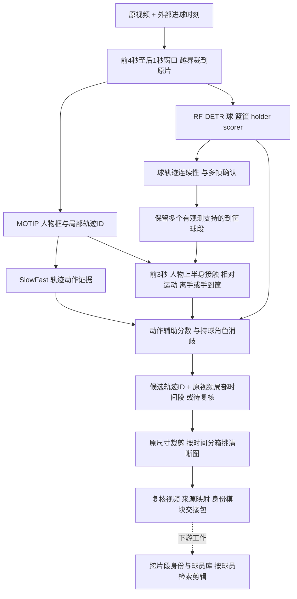

# 进球出手者定位基线：2026-11-06

代码提交：`6be0adb7ab6488697d88378343d0fd8bd6fb0807`。固定标签：
`goal-link-v3-baseline-20261106`。该标签指向文档记录前的可运行代码，
不包含后续 TCEI 实验。仅保留 main、link_player 两个分支，两者不合并。
机器可读版本、关键文件 SHA-256、视频 SHA-256 见同目录 JSON。

## 实际流程

1. **外部事件输入**：CSV/JSON 的 `video_id, filename, goal_time_s`。
   当前十段使用人工进球时刻；系统没有自动发现所有进球，也没有自动生成
   精确的球穿筐时间。未来进球模块可以通过同一接口提供事件。
2. **窗口与时钟**：默认 `[goal-4, goal+1)`，不足时裁到源视频范围；
   检查帧时钟，保存 `source_frame = window_frame + window_start_frame`。
3. **人物轨迹**：支持在窗口内新跑 MOTIP。已完成实验实际复用了整个短片
   已算好的 MOTIP，校验模型/源视频/轨迹哈希后截取窗口，保留原始局部 ID。
   不能把“支持5秒新追踪”写成“本轮MOTIP已经仅输入5秒”。
4. **动作证据**：SlowFast 沿人物框输出投篮类别分数。第二/三轮复用第一轮
   已有推理，并重映射预测中心的时间；它仍保留第一次较宽的推理上下文。
5. **球观测**：篮球专用 RF-DETR 输出球、篮筐、holder、scorer 等类。
   当前配置逐原始帧推理，输入上限约 1344 长边。位置/框尺寸约束、稳健速度
   和新球段多帧支持限制短误检传播；原始候选与预测点分别保留。
6. **到筐球段与出手者**：在进球前3秒内搜索。只让有实际检测且通过时序
   确认的球点参与接触和到筐证据；保留多个有效到筐球段，不强拼不同球ID。
   检查球与上半身框的接近、相对运动稳定性、后续分离；扣篮允许手随球到筐。
   同一球路上后续稳定控制可排除更早的传球者。
7. **证据组合**：原有几何球分数80%、邻近动作分数20%是初始启发式，
   不是概率。将 holder/scorer 框与人物框唯一匹配，多帧持球证据可消解
   几何歧义；scorer 单独不指定球员，持球与明确球证据冲突时保留待复核。
   未使用人体姿态/手腕关键点，也未用人工号码或目标T号指导预测。
8. **交接与复核**：输出局部轨迹区间、原尺寸PNG和256×512人物预览。
   按时间分箱，以清晰度、尺寸和检测分数选图。身份连续性仍是待验证项，
   不能由同一个T号保证。新流程不调用KPR或球员库，`player_id` 保留为空，
   由下游同学匹配身份、维护档案及完成按球员的检索剪辑。

主要实现入口：`cli/link_player.py`、`workflows/link_player.py`、
`pipeline/player_link/{ball_evidence,roles,export}.py`、
`pipeline/ball/tracker.py`、`cli/ball_track.py`。

## 当前可核实的结果与边界

服务器第三轮：`/root/autodl-fs/link-player-demo-003`，用户回传状态为
`completed_not_accuracy_evaluated`，10个事件均完成6/6阶段。

| 视频 | 人工进球时刻/s | 候选轨迹 | 与人工T号核对 |
|---|---:|---|---|
| 3 | 10 | T6 | 一致；整条T6曾换人，目标局部段仍需检查 |
| 6 | 12 | T4 | 一致 |
| 20 | 3.5 | T3 | 一致 |
| 43 | 10 | T9 | 一致 |
| 50 | 5 | T7 | 一致 |
| 68 | 27 | T13 | 一致；人工确认的T8早段不等于进球附近T8 |
| 11 | 7 | T1 | 一致 |
| 30 | 13 | T5 | 一致 |
| 37 | 10 | T0 | 一致 |
| 63 | 12 | T7 | 一致 |

这是参与规则开发的十段上的轨迹ID核对结果，不是独立测试准确率。
局部轨迹纯度、选图质量和片段完整性正在通过轻量复核包检查。
T号只在本次视频/模型运行内有意义，不是球员ID。

第三轮复用了人物、动作和球缓存，因此可以在无卡模式完成。
大规模新视频和新的MOTIP/TCEI推理需要GPU。

PL-NBA 当前公开ZIP含 `made` 结果、动作区间与姓名，但没有单独精确入筐帧；
冒号时间单位未在 README 明确说明，部分标签与人工观察有出入。
它可筛选候选数据，不能直接把动作结束时间当成精确进球真值。

## 后续工作顺序

先进行独立 MOTIP/TCEI 对照；按实际关联指标判断是否接入，再扩大
PL-NBA 的出手者功能测试。具体协议见 `../tcei-evaluation-plan.md`。
此记录不改变追踪或归因实现。
